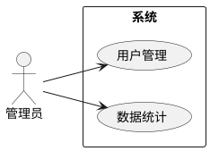

# 需求分析与可行性分析

## 可行性分析（通常 1 节，3 小节）
- **技术可行性**：所选技术成熟、资料多、本人掌握程度；不要只罗列技术名。
- **经济可行性**：开源框架 + 个人电脑即可开发，部署成本（云服务器/免费额度）。
- **操作可行性**：界面符合常见操作习惯，目标用户无需培训或少量培训。
（有的学校要求「法律可行性」「社会可行性」，按模板补。）

## 角色与用例
1. 先列角色表：角色 | 说明 | 主要权限。
2. 每个角色一张用例图，先给 mermaid 或 PlantUML 草稿：

3. 核心用例写**用例描述表**：用例名称 | 参与者 | 前置条件 | 基本流程 | 备选流程 | 后置条件。挑 3–5 个关键用例写，不必全写。

## 功能需求
按模块分小节，每个模块：一段说明 + 功能点列表（增删改查、导入导出、审核流程等）。功能点必须和系统真实实现一致——如果有代码，先用 `code-to-thesis` 技能从代码里提取。

## 非功能需求
性能（如列表查询响应时间目标）、安全（密码加密存储、权限校验、防 SQL 注入）、易用性、兼容性（浏览器/小程序基础库版本）。写成目标，测试章节再用实测数据验证；没测过的数字不要写成「已达到」。

## 业务流程图
关键流程（下单、审核、借还）配活动图或流程图，图下写图号图名「图 3-1 xxx 流程图」。
